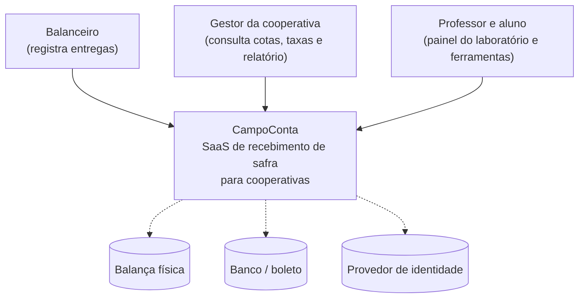
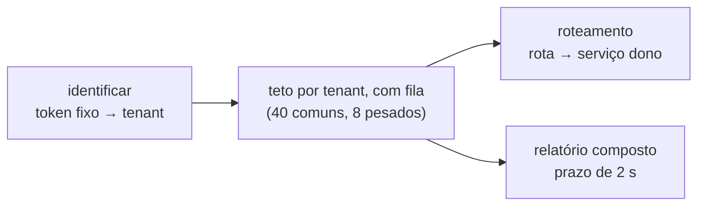

# Diagramas C4 — CampoConta

**Entregável que exemplifica:** Etapa 1, item 1.2 (níveis 1 e 2, esboço do 3), e o checklist "C4 nível 2 mostra os serviços e os limites de tenant".

> **Isto não é o seu PI.** É o exemplo público do CampoConta, material de aula. Um artefato de PI que reproduza este desenho é avaliado como cópia. Use o **formato**; o conteúdo do seu produto é seu.

**Escrito em 12/11/2026.** Descreve o tronco `setrem-ec/saas-campo-conta`, commit `0deac2a`.

Os diagramas estão em Mermaid, que o GitHub desenha sozinho ao abrir este arquivo.

## Nível 1 — Contexto

Quem usa o sistema e com o que ele conversa.

| Elemento | Como está |
|---|---|
| Balanceiro, gestor | São personas, não papéis: cada cooperativa tem um token fixo, e quem tem o token faz tudo |
| Professor e aluno | Usam o painel da porta 8081, que não pede nada |
| Sistemas externos (tracejados) | **Nenhum está integrado.** Estão desenhados para que o limite fique visível: o peso é digitado, não há boleto, e o token é fixo. Integrar qualquer um deles é decisão futura, com ADR |

## Nível 2 — Containers

**Onde está o limite de tenant, e onde ele falha:**
1. O tenant **nasce** no gateway, a partir do token (ADR 001).
2. Ele **viaja** em cabeçalho nas chamadas síncronas e **dentro do evento** na assíncrona (ADR 004).
3. Ele é **verificado** no código e na política por linha (ADR 002), **mas não em toda parte**:
   - a outbox não tem política por linha (C7);
   - a cobrança confia no tenant escrito no evento (C1);
   - produção e cobrança aceitam `x-tenant-id` de qualquer chamador interno (C6).
4. **Rede única:** qualquer container alcança os dois bancos, e a senha é de bancada. Segmentar a rede é assunto de Cloud. Aqui fica declarado como risco.

Os defeitos C1, C6 e C7 estão na lista do `adr/010`.

## Nível 3 — Esboço: componentes do gateway

Os componentes de `producao` e `cobranca` ficam para quando a Etapa 2 pedir mais detalhe.
