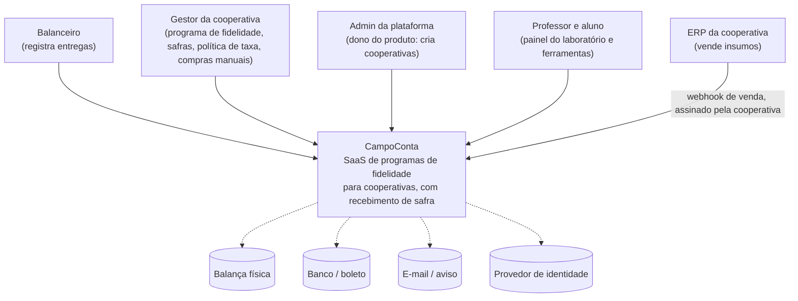
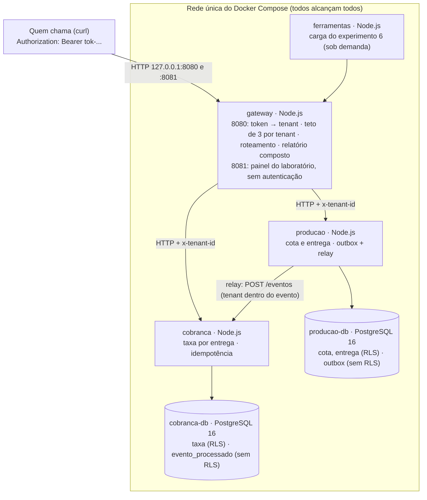
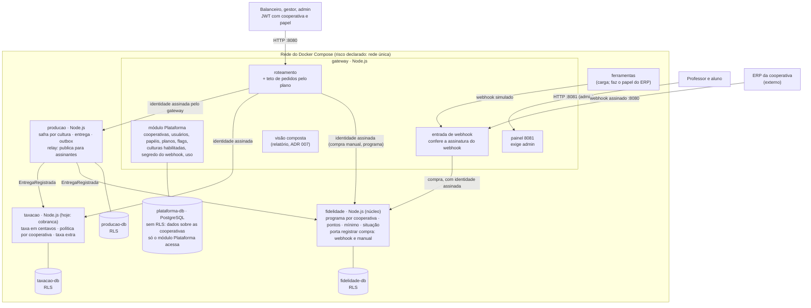
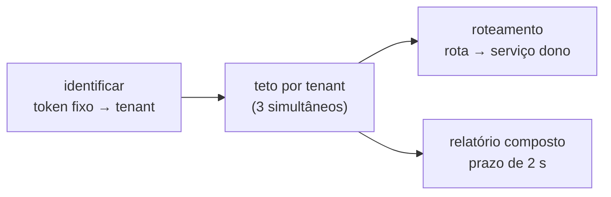
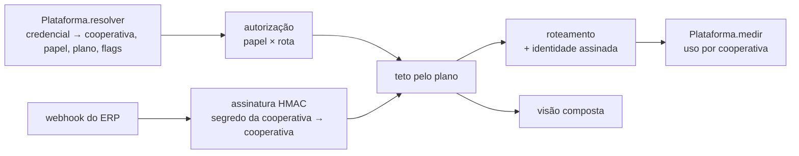

# Diagramas C4 — CampoConta

**Entregável que exemplifica:** Etapa 1, item 1.2 (níveis 1 e 2, esboço do 3), e o checklist "C4 nível 2 mostra os serviços e os limites de tenant".

> **Isto não é o seu PI.** É o exemplo público do CampoConta, material de aula. Um artefato de PI que reproduza este desenho é avaliado como cópia. Use o **formato**; o conteúdo do seu produto é seu.

**Reescrito em 09/11/2026 e fechado em 12/11/2026 (decisões 97, 98 e 104).** O CampoConta passa a ser um **SaaS de programas de fidelidade para cooperativas, com recebimento de safra**.
- **Hoje** é o tronco `setrem-ec/saas-campo-conta`, commit `0deac2a`.
- **Alvo** é o que as fatias vão construir. Nada do alvo existe ainda em código.
- As especificações ("spec NN") e as decisões numeradas citadas aqui são do caderno de construção do professor. As especificações entram no tronco na fatia 1.

Os diagramas estão em Mermaid, que o GitHub desenha sozinho ao abrir este arquivo.

## Nível 1 — Contexto

Quem usa o sistema e com o que ele conversa.

| Elemento | Hoje (`0deac2a`) | Alvo |
|---|---|---|
| Balanceiro, gestor | Só personas: qualquer token faz tudo | Papéis de verdade (decisão 98, D2). O gestor também digita a compra de insumo quando ela não vem do ERP |
| ERP da cooperativa | Não existe | **Sistema externo integrado (decisão 98-I).** Envia a venda de insumo por webhook assinado com o segredo da cooperativa. Na bancada, o container `ferramentas` faz o papel do ERP. Publicar o webhook na internet (domínio, TLS, túnel) é operação, assunto de Cloud |
| Admin da plataforma | Não existe | Papel `admin` |
| Professor e aluno | Usam o painel 8081, que não pede nada | O painel exige `admin` |
| Demais sistemas externos (tracejados) | Nenhum | **Continuam fora do escopo.** Estão desenhados para que o limite fique visível. O peso é digitado; o login é do próprio gateway; o aviso ao gestor (3 vezes o mínimo) aparece na tela, não sai por e-mail. Integrar qualquer um deles é decisão futura, com ADR |

## Nível 2 — Containers

### Hoje (`0deac2a`)

**Onde está o limite de tenant hoje, e onde ele falha:**
1. O tenant **nasce** no gateway, a partir do token (ADR 001).
2. Ele **viaja** em cabeçalho nas chamadas síncronas e **dentro do evento** na assíncrona (ADR 004).
3. Ele é **verificado** no código e na política por linha (ADR 002), **mas não em toda parte**:
   - a outbox não tem política por linha (C7);
   - a cobrança confia no tenant escrito no evento (C1);
   - produção e cobrança aceitam `x-tenant-id` de qualquer chamador interno (C6).
4. **Rede única:** qualquer container alcança os dois bancos, e a senha é de bancada. Segmentar a rede é assunto de Cloud. Aqui fica declarado como risco.

### Alvo

**O que muda do hoje para o alvo:**

| Mudança | Fatia | Defeito que fecha |
|---|---|---|
| Plataforma no gateway, com banco próprio: login, papéis, planos, flags, culturas | 1 (spec 09) | painel sem autenticação |
| Identidade assinada pelo gateway e conferida pelos serviços | 1 (spec 09) | C6 |
| O processo não cai com endereço malformado | 2 | C2 |
| O evento só é aceito da Produção | 5 | C1 |
| Teto de pedidos vem do plano | 1 | — (C10 continua: contador em memória) |
| Taxa em centavos, política por cooperativa e mínimo; taxa extra fora da safra | 6; a taxa extra na 7 | C12 |
| Relay publica para mais de um assinante | 8 | C11 |
| Serviço Fidelidade (núcleo): programa, pontos, porta "registrar compra" | 8 | — |
| Entrada de webhook com assinatura do webhook por cooperativa e idempotência pela venda do ERP | 8 | — (o mesmo mecanismo de assinatura serve para C1) |

**O limite de tenant no alvo:**
1. O tenant e o papel nascem na Plataforma, a partir do login. No webhook, o tenant nasce da **assinatura do webhook**: só a cooperativa que tem o segredo consegue assinar. O que o corpo do webhook diz sobre a cooperativa é ignorado.
2. Os serviços conferem a identidade que o gateway assina.
3. Cada banco de domínio aplica a política por linha.
4. Os dados da Plataforma ficam num banco próprio e **não** têm política por linha, de propósito: são o plano de controle e só o módulo Plataforma, no gateway, os lê. É isso que separa plano de controle de plano de dados.

## Nível 3 — Esboço: componentes do gateway

### Hoje

### Alvo

Os componentes de Fidelidade, Produção e Taxação ficam para quando a Etapa 2 pedir mais detalhe.
