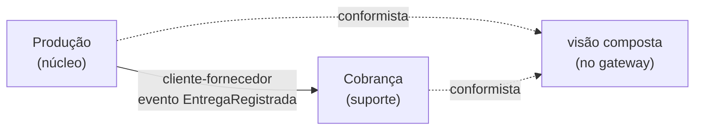

# Mapa de contextos (DDD) — CampoConta

**Entregável que exemplifica:** Etapa 2, item 2.4 (bounded contexts e a relação entre eles), e o checklist "mapa coerente com o C4 da Etapa 1, com as divergências documentadas".

> **Isto não é o seu PI.** É o exemplo público do CampoConta, material de aula. Um artefato de PI que reproduza este mapa (os contextos e as relações) é avaliado como cópia. Use o **formato**; o conteúdo do seu produto é seu.

**Escrito em 12/11/2026.** Descreve o que roda no tronco `setrem-ec/saas-campo-conta`, commit `0deac2a`.

## Os contextos

| Contexto | Tipo | Linguagem própria | Onde está |
|---|---|---|---|
| **Produção** | **núcleo** | Cota em kg, entrega, safra, associado como **quem entrega** | Serviço `producao`, com banco próprio. Recusa a entrega acima da cota |
| **Cobrança** | suporte | Taxa, associado como **quem paga a taxa** | Serviço `cobranca`, com banco próprio. Cobra R$ 0,05 por kg |
| Visão composta | **não é contexto** | Nenhuma: só junta o que os dois contextos devolvem | Composição dentro do gateway (ADR 007) |

**A palavra "associado" tem dois sentidos.** Na Produção, é quem entrega e tem cota. Na Cobrança, é quem paga a taxa. Nos dois, hoje, é só um código em texto (`A-017`): não existe cadastro de associado.

**"Cobrança" tem dois sentidos neste repositório.** No produto, é a taxa que a cooperativa cobra do associado por entrega. Na demo do Encontro 10 (`aula/enc10`), "faturamento" é a loja cobrando o cliente, outro domínio, fora do CampoConta.

## As relações

| Seta | Tipo | Por quê, em uma linha |
|---|---|---|
| Produção → Cobrança | **Cliente-fornecedor** | A Cobrança precisa saber de cada entrega para gerar a taxa. A Produção fornece o evento `EntregaRegistrada`, e o contrato dele está em `especificacao.md` |
| Produção, Cobrança → visão composta | **Conformista** | O relatório aceita o formato que cada serviço devolve, sem negociar |

## Por que a Produção não chama a Cobrança na hora da entrega

A balança não pode parar (`visao.md`). A Produção grava a entrega e o evento na mesma transação (ADR 004). A Cobrança recebe o evento depois. Se ela estiver fora do ar, a entrega continua sendo registrada, e a taxa aparece quando ela voltar. No experimento 4, 5 de 5 entregas foram registradas com a Cobrança parada.

## Coerência com o C4 e divergências

- Cada contexto é um container no nível 2 de `c4.md`, com banco próprio (ADR 003). **Coerente.**
- **Divergência 1:** a visão composta aparece no mapa, mas não é contexto nem serviço. Ela mora no gateway (ADR 007), porque não tem regra de negócio nem dado próprio.
- **Divergência 2, com o mapa do Encontro 08:** aquele mapa trazia também "Associados" e "Relatórios" como contextos. Aqui não existem: o associado é só um código, e o relatório é a visão composta. Dois serviços de domínio bastam para mostrar a conversa.
- **Termo resolvido:** "lote" (exemplo do Encontro 08) e "entrega" (sistema) são a mesma coisa. A palavra é **entrega**.
