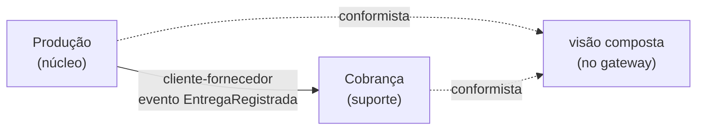
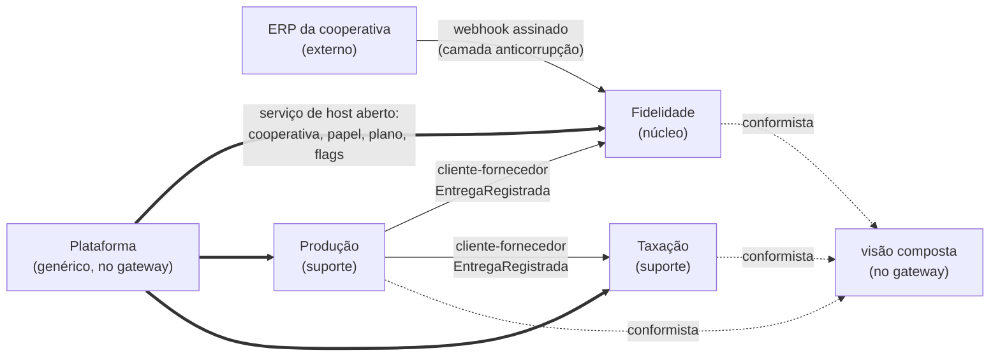

# Mapa de contextos (DDD) — CampoConta

**Entregável que exemplifica:** Etapa 2, item 2.4 (bounded contexts e a relação entre eles), e o checklist "mapa coerente com o C4 da Etapa 1, com as divergências documentadas".

> **Isto não é o seu PI.** É o exemplo público do CampoConta, material de aula. Um artefato de PI que reproduza este mapa (os contextos e as relações) é avaliado como cópia. Use o **formato**; o conteúdo do seu produto é seu.

**Reescrito em 09/11/2026 e fechado em 12/11/2026 (decisões 97, 98 e 104).** O CampoConta passa a ser um **SaaS de programas de fidelidade para cooperativas, com recebimento de safra**. Cada cooperativa configura o seu programa. Este mapa mostra dois momentos:
- **Hoje** é o que roda no tronco `setrem-ec/saas-campo-conta`, commit `0deac2a`.
- **Alvo** é o que o produto vai ter, fatia a fatia. Nada do alvo existe ainda em código.

As especificações ("spec NN") e as decisões numeradas citadas aqui são do caderno de construção do professor. As especificações entram no tronco na fatia 1.

## Os contextos

| Contexto | Tipo | Linguagem própria | Hoje (`0deac2a`) | Alvo |
|---|---|---|---|---|
| **Fidelidade** (era Associados) | **núcleo** | Programa, pontos, mínimo anual, situação no ano, benefício, compra de insumo, associado como **sócio** | Não existe: o associado é só um código em texto | **Serviço próprio, com banco próprio.** Cada cooperativa configura o **seu programa**: tabela de conversão (produto, unidade, fator, vigência), mínimo anual, faixas e benefícios. Os **pontos** vêm da entrega (evento da Produção) e da **compra de insumo**. A compra entra por uma porta só, "registrar compra", com dois adapters: o webhook do ERP da cooperativa e a digitação do gestor. Apuração no **ano civil**. Situação **regular** ou **irregular**: abaixo do mínimo corta benefícios. Compra **a prazo** eleva o mínimo do ano. Acima de 3 vezes o mínimo, o gestor recebe um **aviso**. Cadastro mínimo do associado |
| **Produção** | suporte | Safra, cultura, entrega, quantidade com unidade, associado como **quem entrega** | Serviço `producao`: cota em kg que recusa a entrega acima do limite; safra é texto | Safra **por cultura**, aberta e encerrada pelo gestor. Entrega depois do encerramento é **aceita** e marcada "fora da safra". Quantidade com unidade (saca de 60 kg, kg, litro). A cota em kg de hoje **sai** (professor, 10/11): a entrega nunca é recusada por volume, e o planejamento de recebimento fica com o aviso de 3 vezes o mínimo, na Fidelidade |
| **Taxação** (era Cobrança) | suporte | Taxa, política de taxa, associado como **quem paga a taxa** | Serviço `cobranca`: R$ 0,05/kg, fixo, em ponto flutuante | Taxa em **centavos inteiros**, com **política por cooperativa**: alíquota, mínimo de R$ 10,00 (spec 03) e **taxa extra** fora da safra (50% da taxa, meio centavo para baixo; percentual por cooperativa). Para de confiar no tenant escrito no evento (C1) |
| **Plataforma** | genérico do SaaS | Cooperativa (tenant), usuário, papel, plano, flag, cultura habilitada, segredo do webhook, **assinatura e uso** | Não existe: o tenant nasce num mapa de tokens no gateway | **Módulo dentro do gateway**, não serviço. Cooperativas, usuários e três papéis (balanceiro, gestor, admin). Dois planos e três flags. Catálogo padrão de culturas, com as que cada cooperativa aceita. **Segredo do webhook por cooperativa**. Medição de uso. Os dados são **sobre** as cooperativas e não têm política por linha. Ficam num **banco próprio da Plataforma**, que só o módulo acessa (professor, 12/11) |
| Visão composta (era Relatórios) | **não é contexto** | Nenhuma: só junta o que os contextos devolvem | Composição dentro do gateway (ADR 007) | Continua composição no gateway. Não tem regra de negócio nem dado próprio, por isso saiu da lista de contextos (professor, 12/11) |
| Venda de insumos | **externo** | O ERP da cooperativa | — | **Não é do CampoConta.** A cooperativa vende no ERP dela, e o CampoConta só **recebe o fato** por webhook, através da camada anticorrupção da Fidelidade. Barter, CPR e cobrança da dívida ficam no ERP |

**A palavra "associado" tem quatro sentidos:**
- na Produção, é quem entrega;
- na Taxação, é quem paga a taxa;
- no ERP da cooperativa, é o cliente que compra insumo;
- na Fidelidade, é o sócio, com pontos e situação.

Só a Fidelidade tem o cadastro do associado. A camada anticorrupção traduz o "cliente" do ERP para o "associado" do CampoConta.

**De onde vem a regra dos pontos.** O estudo de domínio (`estudo-dominio-cooperativas.md`) achou um programa real de pontos, o Coamo Fideliza (2018). Ele pontua a **compra de insumos**, com fator por cultura. O retorno de sobras usa **reais por unidade** entregue. O CampoConta junta as duas ideias num programa configurável por cooperativa. A parte da entrega é regra das cooperativas fictícias, e isso se diz em sala.

## Três "cobranças" com nomes separados

| Quem cobra de quem | Termo | Onde mora |
|---|---|---|
| A cooperativa cobra o associado por entrega | **taxa** | Taxação |
| O SaaS cobra a cooperativa | **assinatura e uso** | Plataforma (spec 07; só medição e planilha, sem cobrança real) |
| A loja cobra o cliente, na demo do Encontro 10 | **faturamento** | Outro domínio, fora do CampoConta (`aula/enc10`) |

A venda de insumos da cooperativa não é nenhuma das três: é do ERP. O CampoConta só a usa para dar pontos.

## As relações

### Hoje (`0deac2a`)

### Alvo

| Seta | Tipo | Por quê, em uma linha |
|---|---|---|
| Plataforma → todos | **Serviço de host aberto** | A Plataforma diz quem chama (cooperativa, papel, plano). Os outros contextos aceitam isso e nada mais |
| ERP → Fidelidade | **Camada anticorrupção** | O formato do ERP muda de cooperativa para cooperativa. A Fidelidade traduz o webhook para a sua linguagem e não deixa o modelo do ERP entrar. O gateway confere a **assinatura do webhook**, feita com o segredo da cooperativa, e não aceita a venda repetida (idempotência pelo identificador da venda no ERP) |
| Produção → Fidelidade | **Cliente-fornecedor** | Cada entrega dá pontos. A Fidelidade é o **segundo consumidor** do mesmo evento. Com dois consumidores, a Produção não pode continuar sabendo o endereço de cada um (C11): o envio passa a ser **publicação para assinantes**, que é o conceito de broker. Operar um broker gerenciado é Cloud |
| Produção → Taxação | **Cliente-fornecedor** | A Taxação precisa de cultura, quantidade e "fora da safra". O contrato do evento passa a ter campos e versão, testados pela spec 04 |
| Fidelidade, Produção, Taxação → visão composta | **Conformista** | O relatório aceita o formato que cada serviço devolve |
| Fidelidade e Taxação | **Nenhuma relação**, de propósito | O benefício do associado regular é uma lista em texto, e o ERP o aplica (professor, 10/11). A Taxação não precisa saber a situação do associado. Se um dia o benefício for desconto na taxa, nasce aqui uma seta nova, com contrato próprio |

### O evento `EntregaRegistrada` no alvo (contrato previsto)

Os campos novos são o contrato previsto (professor, 12/11). O contrato fecha na especificação da fatia de safra e pode mudar até lá.

| Campo | Hoje | Alvo |
|---|---|---|
| `id`, `tipo`, `tenant_id` | sim | sim (o `tenant_id` passa a ser conferido, C1) |
| `entrega_id`, `associado`, `safra`, `kg` | sim | `kg` vira `quantidade` + `unidade`; `safra` aponta para a safra **da cultura** |
| `cultura` | não | sim (o fator de pontos é por cultura) |
| `fora_da_safra` | não | sim (a Taxação aplica a taxa extra) |

### A compra de insumo, na porta "registrar compra" (contrato previsto)

Contrato previsto (professor, 12/11). Ele fecha na especificação da fatia de Fidelidade e pode mudar até lá.

| Campo | Sentido |
|---|---|
| `id_venda_erp` | Identificador da venda no ERP. É a chave da idempotência: o ERP pode reenviar |
| `associado`, `cultura` | Quem comprou e a cultura a que o insumo se destina |
| `valor_centavos` | Valor da compra, em centavos inteiros |
| `a_prazo` | Se é para pagar na safra; se sim, o mínimo do ano sobe |
| `origem` | `webhook` ou `manual` (digitado pelo gestor) |

## Por que a Produção não chama a Fidelidade nem a Taxação na hora da entrega

A balança não pode parar (`visao.md`). A entrega é gravada com o evento na mesma transação (outbox). A Fidelidade e a Taxação recebem o evento depois. Se qualquer uma estiver fora do ar, a entrega continua sendo registrada, e os pontos e a taxa aparecem quando ela voltar.

## Coerência com o C4 e divergências

- Cada contexto com serviço é um container no nível 2 de `c4.md`, com banco próprio (ADR 003). **Coerente** hoje e no alvo.
- **Divergência 1:** a Plataforma é contexto, mas não é serviço. É um módulo do gateway, com banco próprio (decisão 98, D1; banco decidido em 12/11).
- **Divergência 2:** a visão composta mora no gateway (ADR 007).
- **Divergência 3, com o mapa do Encontro 08:** aquele mapa trazia "Relatórios" e "Associados" como contextos. Relatórios virou visão composta, porque não tem modelo próprio. Associados virou a Fidelidade, que é o núcleo.
- **O ERP da cooperativa é sistema externo** no nível 1 do C4. No alvo, na bancada, o container `ferramentas` fará o papel dele e enviará webhooks assinados. Hoje ele só gera a carga do experimento 6.
- **Termo resolvido:** "lote" (exemplo do Encontro 08) e "entrega" (sistema) são a mesma coisa. A palavra é **entrega** (decisão 97-I).
